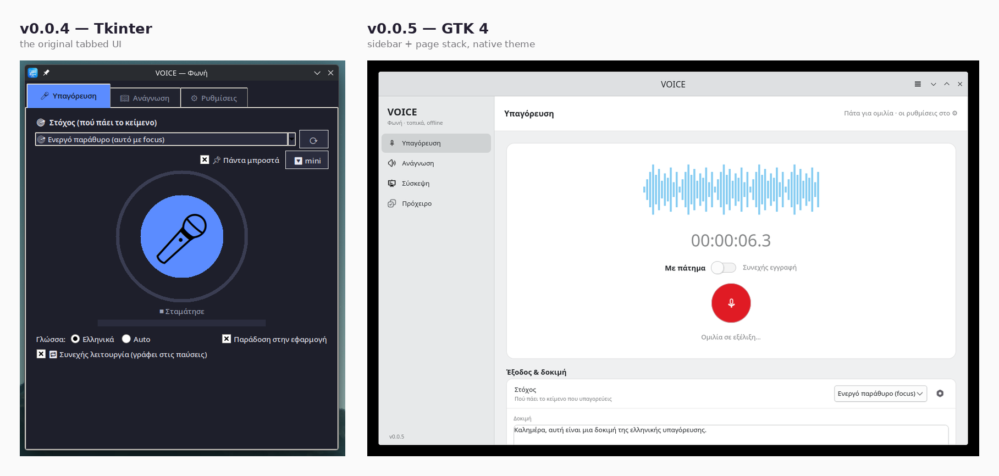

# Changelog

All notable changes to VOICE are documented here.

## v0.0.5 — GTK 4 interface

The interface was rebuilt in **GTK 4**, from a PixelRuller design
(`Assets/VoiceGTK.pixelruller.json`, kept in the repo as the source of truth
for the UI). The new UI ships as `voice-gtk`; the original Tk interface stays
available as `voice`, unchanged.

### Added

- **GTK 4 interface (`voice-gtk`)** — sidebar + page stack replacing the tab
  bar, with the pages Υπαγόρευση / Ανάγνωση / Σύσκεψη / Πρόχειρο and a
  Ρυθμίσεις page reached from the hamburger menu.
- **Native theming** — no hardcoded accent colours. Buttons use GTK style
  classes (`.suggested-action`, `.destructive-action`) and custom CSS is
  geometry-only, so the app follows whatever theme and accent colour the
  desktop is set to, in light or dark.
- **Live waveform** — dictation and meeting capture draw the real microphone
  level as a bar waveform while recording, next to a running timer.
- **Modal dialogs** — Παράδοση κειμένου (delivery target + paste/Enter/focus
  toggles), Ορισμός συντόμευσης (captures the key combination you actually
  press), Καθαρισμός προχείρου, and a native About dialog.
- **Two-column clipboard grid** — history cards with image thumbnails, pin,
  delete, and read-aloud per item.
- **Mini bar** — an undecorated always-on-top pill with 🎤 / 🔊 / 📋 whose
  clipboard list expands inline; the main window collapses into it on close.
- **Settings persistence** — language, voice, speed, microphone, delivery,
  meeting source and feature toggles are written to
  `~/.config/voicekbd/config` and restored on start. The microphone key stays
  compatible with `dictate.sh`.
- **Feature toggles** — switching a feature off in Ρυθμίσεις → Λειτουργίες
  now hides it everywhere: its sidebar page *and* its mini-bar button.
- Project icon set under `Assets/SVGs/` (microphone on/off, speaker on/off,
  meeting, clipboard, pin, gear) in matching light and dark variants.

### Fixed

- **Dictated text arriving twice.** Every take was written to one fixed temp
  file (`/tmp/voice_gtk_dict.wav`) and transcribed on its own thread, so
  overlapping takes overwrote each other's audio and the same speech came back
  twice. Transcription now runs on a single worker queue with a unique temp
  file per take.
- **Input flood after pressing stop.** Segments already queued kept being
  transcribed, activating windows and pasting long after capture stopped —
  which feels like the app clicking all over the desktop. Stopping now drops
  the backlog and invalidates work already in flight, so nothing is delivered
  after you stop. (Same class of bug as the v0.0.4 fix for the Tk app.)
- **Capture process left running** after stop in some cases; the recorder now
  terminates, then kills, and reaps it.
- **Missing window icon.** GTK 4 only takes window icons from the icon theme,
  so the app now ships a `hicolor` copy of its icon and registers it, and the
  GTK desktop entry is named after the application-id
  (`io.github.kalotrapezis.voice.desktop`) so Wayland compositors match the
  window to it.

### Changed

- Global shortcuts are registered by the GTK app the same way as before
  (`.desktop` entries with `X-KDE-Shortcuts` on KDE, `gsettings` custom
  keybindings on Cinnamon/GNOME) and drive the **same control socket**, so
  both interfaces respond to the same hotkeys.
- The `.deb` now installs both `voice` and `voice-gtk`, with a desktop entry
  for each, and depends on `gir1.2-gtk-4.0`.

### Notes

- The GTK app requires GTK 4 (`gir1.2-gtk-4.0`); libadwaita is **not** needed.
- "Πάντα μπροστά" uses `wmctrl` and therefore applies on X11 sessions. On
  Wayland, GTK 4 exposes no keep-above API — add a KWin window rule for the
  window title *VOICE Mini* to pin the mini bar.
- The system-tray icon currently lives only in the Tk interface (`voice`).

## v0.0.4

- Fixed a paste backlog that could fire after stopping continuous dictation.
- Added per-tab feature toggles.
- Fixed the mini clipboard: pin button stays visible, opens at the pointer on
  top.
- Fixed continuous (auto-pause) capture by using `parec` instead of
  `pw-record --raw`, which did not reliably convert to the requested format.

## v0.0.3

- Cross-distro support: Debian/Ubuntu/Linux Mint/Kubuntu alongside Fedora, with
  the desktop/session differences abstracted in `platform_io.py` (KWin vs
  wmctrl, ydotool vs xdotool, wl-clipboard vs xclip) and a `.deb` build script.
- Clipboard manager: history with image thumbnails, pinning, case-copy, and an
  always-on-top mini view.

## v0.0.2

- Meeting transcription: system-audio or microphone capture with a live
  timestamped transcript, exported to Markdown.

## v0.0.1

- First release: Greek dictation (whisper.cpp), read-aloud (Piper), voice
  remote, continuous mode, mini mode, tray icon and global shortcuts.
