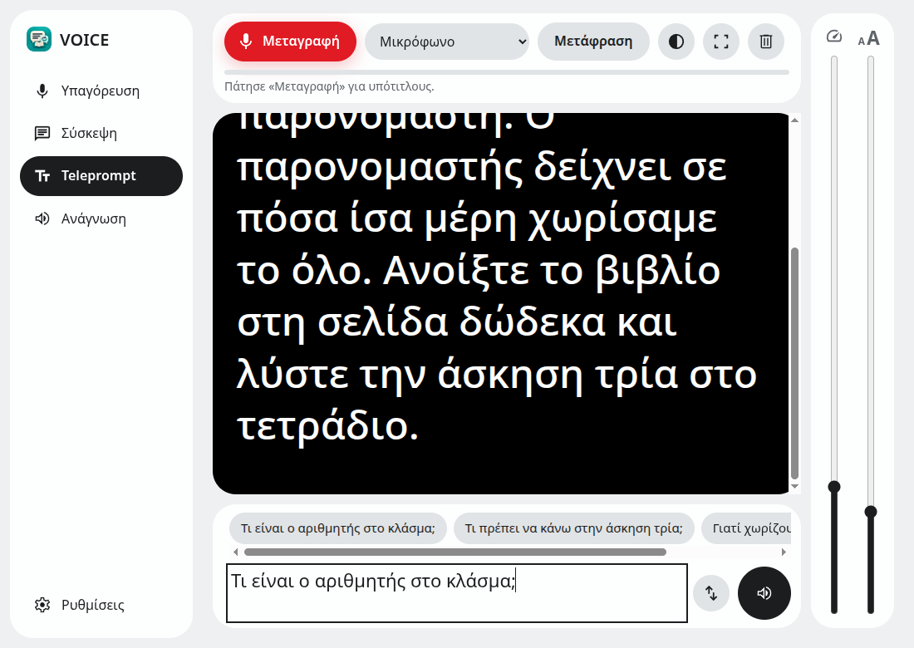
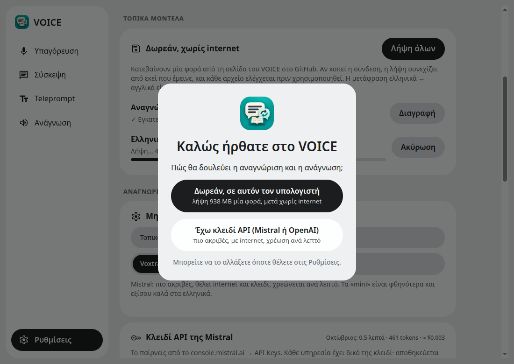
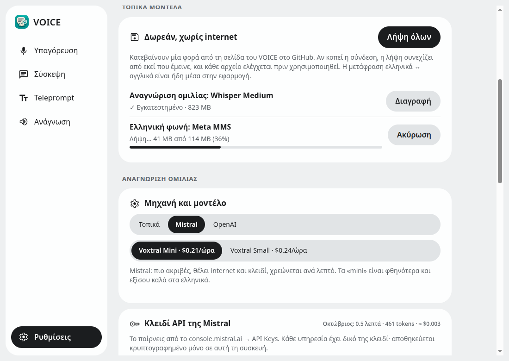

> [!WARNING]
> **BETA: δεν έχει δοκιμαστεί ακόμα σε εκπαιδευτικό περιβάλλον.**

<p align="center"></p>

<h1 align="center">VOICE</h1>

<p align="center"><b>Υπότιτλοι, μετάφραση και ανάγνωση στα ελληνικά, για την τάξη.</b><br>
Για τον μαθητή που δεν ακούει, για τον μαθητή που δεν ξέρει ελληνικά, και για τον εκπαιδευτικό που θέλει πρακτικά
του μαθήματος. Δωρεάν και χωρίς internet, ή με κλειδί Mistral / OpenAI για όποιο σχολείο θέλει ακόμα μεγαλύτερη ακρίβεια.</p>

<p align="center"><a href="https://kalotrapezis.github.io/Voice/"><b>kalotrapezis.github.io/Voice</b></a></p>

## Λήψη

**0.1.0 Beta 1** ([τι νέο υπάρχει](https://github.com/kalotrapezis/Voice/releases/tag/v0.1.0-beta.1)). Είναι beta:
δοκιμάστε το πρώτα εσείς, πριν το δώσετε σε μαθητή.

### 🐧 Linux

<p>
  <a href="https://github.com/kalotrapezis/Voice/releases/download/v0.1.0-beta.1/VOICE-0.1.0-beta.1.AppImage"></a>
  <a href="https://github.com/kalotrapezis/Voice/releases/download/v0.1.0-beta.1/voice-desktop_0.1.0-beta.1_amd64.deb"></a>
</p>

Το **.deb** εγκαθίσταται με διπλό κλικ σε Ubuntu, Linux Mint και Debian. Το **AppImage** τρέχει παντού: δεξί κλικ →
Ιδιότητες → «Να επιτρέπεται η εκτέλεση», και διπλό κλικ. Αν δεν ανοίγει, λείπει μια βιβλιοθήκη που τα νεότερα Ubuntu
δεν έχουν πια από μόνα τους: `sudo apt install libfuse2t64` (Ubuntu 24.04 / Mint 22) ή `sudo apt install libfuse2`.

| Τι χρειάζεται | Με κλειδί API | Τοπικά, χωρίς internet |
|---|---|---|
| **Σύστημα** | Ubuntu 22.04, Linux Mint 21, Debian 12, Fedora 36 ή νεότερο, 64-bit (x86-64) | ίδιο |
| **Επεξεργαστής** | οποιοσδήποτε 64-bit διπύρηνος | **4 πυρήνες** τουλάχιστον· άνετα με **6–8 πυρήνες** (Ryzen 5 / Core i5 από το 2018 και μετά) |
| **Μνήμη (RAM)** | 4 GB | **8 GB** (το Whisper πιάνει ~1,5 GB, η φωνή ~0,3 GB) |
| **Κάρτα γραφικών** | δεν χρειάζεται | προαιρετική, αλλά κάνει την αναγνώριση **3–4 φορές πιο γρήγορη**: οποιαδήποτε με Vulkan 1.2, ακόμα και ενσωματωμένη (AMD Radeon Vega και νεότερες, Intel UHD 620 / Iris Xe, NVIDIA GTX 900 και νεότερες). Χρησιμοποιείται από Ubuntu 24.04 / Mint 22 / Debian 13 / Fedora 39 και μετά· στα παλιότερα η αναγνώριση τρέχει στον επεξεργαστή. |
| **Δίσκος** | ~500 MB | ~1,5 GB (η εφαρμογή και τα μοντέλα, ~940 MB) |
| **Ήχος** | PipeWire ή PulseAudio (όλες οι σύγχρονες διανομές)· για τον ήχο του υπολογιστή το `pactl`/`parec` (πακέτο `pulseaudio-utils`) | ίδιο |

Ταχύτητα της τοπικής αναγνώρισης, σε ένα λάπτοπ με Ryzen 7 7730U (8 πυρήνες) και ενσωματωμένη Radeon:
**~1,6 δευτερόλεπτα** για 15 δευτερόλεπτα ομιλίας με την κάρτα γραφικών, **~5 δευτερόλεπτα** μόνο με τον
επεξεργαστή. Σε τετραπύρηνο χωρίς κάρτα γραφικών θα είναι περίπου διπλάσιο: αρκεί για υπότιτλους σε αργή ομιλία,
αλλιώς προτιμήστε κλειδί API. Για το mini παράθυρο, που γράφει σε άλλες εφαρμογές, χρειάζεται το `ydotool` (Wayland)
ή το `xdotool` (X11).

### 🪟 Windows

<p>
  <a href="https://github.com/kalotrapezis/Voice/releases/download/v0.1.0-beta.1/VOICE-0.1.0-beta.1.exe"></a>
</p>

Windows 10 ή 11, 64-bit. Όλα δουλεύουν και **χωρίς internet**: αναγνώριση ομιλίας, μετάφραση ελληνικά ↔ αγγλικά
και ελληνική φωνή, αφού κατεβούν μία φορά τα μοντέλα. Τοπικά θέλει 8 GB μνήμη και 4 πυρήνες· η αναγνώριση τρέχει
στον επεξεργαστή, άρα είναι πιο αργή απ' ό,τι στο Linux με κάρτα γραφικών (με κλειδί API αρκούν 4 GB). Είναι φορητό πρόγραμμα: δεν θέλει εγκατάσταση, ανοίγει με διπλό κλικ.
Τα Windows μπορεί να προειδοποιήσουν ότι η εφαρμογή δεν είναι υπογεγραμμένη: «Περισσότερες πληροφορίες» → «Εκτέλεση».

### 🤖 Android (tablet και κινητό)

<p>
  <a href="https://github.com/kalotrapezis/Voice/releases/download/v0.1.0-beta.1/VOICE-0.1.0-beta.1.apk"></a>
</p>

Android 7 ή νεότερο. Η αναγνώριση γίνεται στη συσκευή:

| Android | Τι δουλεύει |
|---|---|
| 13 και νεότερα | Όλα, χωρίς internet· τα ελληνικά κατεβαίνουν από τις Ρυθμίσεις της εφαρμογής. |
| 12 | Όλα, χωρίς internet· τα ελληνικά κατεβαίνουν από την εφαρμογή Google. |
| 7–11 | Η αναγνώριση θέλει την εφαρμογή Google και συνήθως internet. Τα υπόλοιπα κανονικά. |

Η μετάφραση ελληνικά ↔ αγγλικά είναι μέσα στο APK και δουλεύει χωρίς internet. Κατεβάστε το APK στη συσκευή,
ανοίξτε το από τα Αρχεία → Λήψεις και επιτρέψτε την εγκατάσταση.



## Τι κάνει

- **Teleprompt: υπότιτλοι για μαθητή που δεν ακούει.** Ό,τι λέτε γράφεται με μεγάλα γράμματα που κυλούν αργά. Το
  μέγεθος και η ταχύτητα αλλάζουν με δύο ρυθμιστικά, και με δόνηση σε κάθε βήμα στο tablet. Φωτεινό ή σκούρο φόντο,
  πλήρης οθόνη.
- **Ο μαθητής απαντά.** Γράφει στο «Μήνυμα στον δάσκαλο» και το tablet το διαβάζει φωναχτά. Ένα κουμπί ανεβάζει το
  πλαίσιο ψηλά, για να μην το κρύβει το πληκτρολόγιο. Με τις **Γρήγορες ερωτήσεις** βλέπει τρεις έτοιμες ερωτήσεις
  από όσα είπατε και ρωτά με ένα άγγιγμα.
- **Μετάφραση για μαθητές που δεν ξέρουν ελληνικά.** Ελληνικά ↔ αγγλικά **χωρίς internet**, με τα μοντέλα του Firefox,
  μέσα σε κλάσματα του δευτερολέπτου. Με κλειδί Mistral ή OpenAI και σε αλβανικά, αραβικά, ουκρανικά και άλλες
  γλώσσες. Γράφεται μόνο η μετάφραση, για να μην περιμένει ο μαθητής δύο κείμενα.
- **Σύσκεψη: πρακτικά.** Από το μικρόφωνο, τον ήχο του υπολογιστή (βιντεοκλήση, YouTube) ή και τα δύο, με ώρα δίπλα
  σε κάθε φράση και αποθήκευση σε αρχείο. Με Mistral ξεχωρίζει και τους ομιλητές.
- **Υπαγόρευση και mini παράθυρο.** Μια μικρή μπάρα, πάντα μπροστά, που γράφει ό,τι λέτε εκεί που είναι ο κέρσορας,
  σε όποια εφαρμογή.
- **Ανάγνωση.** Ανοίξτε ένα PDF ή ένα κείμενο και ακούστε το: με την ελληνική φωνή Meta MMS (χωρίς internet) ή με τις
  φωνές της Mistral και της OpenAI.



## Δωρεάν και χωρίς internet, ή με κλειδί

Την πρώτη φορά το VOICE ρωτά πώς θα δουλεύει:

- **Δωρεάν, σε αυτόν τον υπολογιστή.** Κατεβάζει μία φορά τα μοντέλα (~940 MB): την αναγνώριση ομιλίας Whisper και την
  ελληνική φωνή. Αν κοπεί η σύνδεση, η λήψη συνεχίζει από εκεί που έμεινε, και κάθε αρχείο ελέγχεται πριν
  χρησιμοποιηθεί. Τα μοντέλα φυλάσσονται στο δικό μας [αποθετήριο μοντέλων](https://github.com/kalotrapezis/voice-models),
  για να μην αλλάξουν ποτέ οι σύνδεσμοι. Με κάρτα γραφικών (AMD, Intel, NVIDIA μέσω Vulkan) η αναγνώριση θέλει 1–2
  δευτερόλεπτα ανά φράση.
- **Με κλειδί API.** Mistral (Voxtral) ή OpenAI: πιο ακριβής αναγνώριση, μετάφραση σε περισσότερες γλώσσες, γρήγορες
  ερωτήσεις. Χρέωση ανά λεπτό· η κάρτα του κλειδιού δείχνει πόσα λεπτά, tokens και περίπου πόσα χρήματα ξοδεύτηκαν
  τον μήνα. Ενδεικτικά, η αναγνώριση με Voxtral Mini κοστίζει περίπου 0,21 $ την ώρα.

Τα κλειδιά μένουν κρυπτογραφημένα μόνο στη συσκευή. Ο ήχος, όταν δουλεύετε τοπικά, δεν φεύγει ποτέ από αυτήν.



## Για προγραμματιστές

Η εφαρμογή είναι μία σελίδα (`web/`) με δύο κελύφη: Electron για υπολογιστή (`electron/`) και Android (`android/`).

```bash
tools/fetch-models.sh            # τα μοντέλα μετάφρασης (all: και τα υπόλοιπα)
tools/build-whisper-portable.sh  # το whisper.cpp για τα πακέτα (θέλει podman)
cd electron && npm install && npm start
npm run dist:linux               # AppImage και .deb
sh ../android/build.sh           # το APK
```

Η παλιότερη εφαρμογή GTK για Linux (πληκτρολόγιο φωνής, πρόχειρο, σημειωματάριο) περιγράφεται στο
[README-GTK.md](README-GTK.md).

## Άδειες

Ο κώδικας: δείτε το [LICENSE](LICENSE). Τα μοντέλα και οι βιβλιοθήκες που περιέχει έχουν τις δικές τους άδειες,
με αναφορές και αλλαγές, στο [THIRD-PARTY-NOTICES.md](THIRD-PARTY-NOTICES.md): Whisper (MIT), μετάφραση του Firefox
(MPL 2.0), **Meta MMS (CC BY-NC 4.0, μόνο μη εμπορική χρήση)**. Γι' αυτό το VOICE μοιράζεται δωρεάν.
