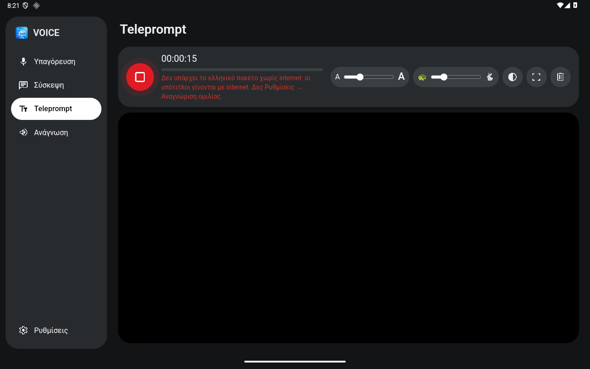

# VOICE για Android

The same UI as the desktop app: the folder [`../web`](../web) is copied into the APK's assets and runs in a WebView. Interface in Greek.

- **Υπαγόρευση** (dictation)
- **Σύσκεψη** (meeting)
- **Teleprompt**: live captions in large type, for reading from a distance
- **Ανάγνωση** (read aloud)
- **Ρυθμίσεις** (settings)

Speech recognition runs **on the device** by default: it is free, and the audio doesn't go to the cloud. Mistral Voxtral is an option in Settings.



## Installing on a tablet

1. Copy `voice-debug.apk` to the device and open it. Allow "install from unknown sources".
2. **Once, on Wi-Fi:** under **Ρυθμίσεις → Αναγνώριση ομιλίας**, see what the device has.
   - If the **"Λήψη ελληνικών…"** (download Greek) button appears, press it. This is Android 13+.
   - Otherwise download Greek from the Google app. The menus vary between versions; roughly: Google app → Settings → Voice → Offline speech recognition → Greek.

## What works without internet (typical school tablet)

| Device | Greek captions without internet? |
|---|---|
| Google app with the **Greek offline pack** downloaded | **Yes.** The app asks for `EXTRA_PREFER_OFFLINE` and uses the pack. |
| Android 13+ where the on-device recogniser lists Greek | Yes. The app uses `createOnDeviceSpeechRecognizer` first. |
| No Greek pack | **No:** recognition goes **through the internet** (Google), and the app says so in red. Captions keep running as long as there is Wi-Fi. |
| No Google app or other recognition service | No local recognition. Use Mistral, which needs internet and a key. |

- The Android 36 emulator image did **not** have Greek in the on-device recogniser, and Google's offline Greek pack was not downloaded. The app correctly fell back to the online service.
- On a real tablet, check the hint in Ρυθμίσεις: it says which case applies.
- **Read aloud** (system TTS) works without internet once the Greek voice is installed.

## Teleprompt

- Large letters: 64 px by default, readable from about 1 m. Resize with the **slider**, by **pinching**, or in Settings.
- New words appear **as they are spoken** (partial results, shown slightly fainter), then settle as final text. After a 6 s pause a new paragraph starts.
- It **scrolls slowly and smoothly** to the newest line. The **speed** is set by a slider, defaulting to slow.
  - If the pupil scrolls back, following stops and **"↓ Ζωντανά"** (live) appears.
- **Full screen** hides the system bars. There is a dark/light high-contrast toggle, and the screen stays on while captions run.
- Size, speed and contrast are saved on the device and apply immediately, without stopping the captions.
- The last 200 paragraphs are kept on the device until **Καθαρισμός** (clear).

## Captions that never stop

- `SpeechRecognizer` stops after every phrase, so the app starts it again immediately. Between phrases there is a gap of about ½ s in which words may be lost.
- Google's recogniser beeps on every restart. While captions run, the app **mutes the media volume** (`STREAM_MUSIC`) and restores it on stop.
- On errors (busy, network) it tries again by itself.

## Building

You only need the Android SDK (build-tools and `platforms;android-36`) and JDK 17+. There is no Gradle and there are no libraries. If `node` is installed, the build also runs the self-check of the shared core.

```bash
./build.sh
```

To install over USB with debugging on:

```bash
adb install -r voice-debug.apk
```

## What the Java side does (`MainActivity.java`)

`window.VoiceAndroid` exposes:

- `listen` / `checkRecognizer` / `downloadGreek`: SpeechRecognizer in `el-GR`, on-device first, falling back to the service and then to online. Events go to `window.onRecog`.
- `getKey` / `setKey`: the Mistral key, encrypted with AES-GCM using a key in the **Android Keystore**. Backup is turned off.
- `speak` / `stopSpeak` / `ttsInfo`: the system TTS in Greek.
- `share`, `keepAwake`, `fullscreen`.

## Limitations

- There are no captions with the screen locked or the app in the background.
- On-device recognition doesn't separate speakers: the meeting shows only timestamps. Speaker labels need Mistral.
