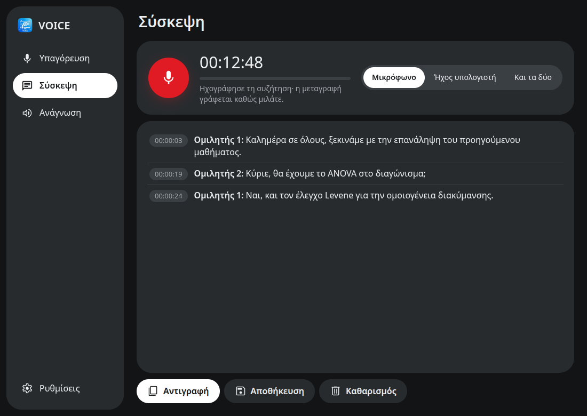
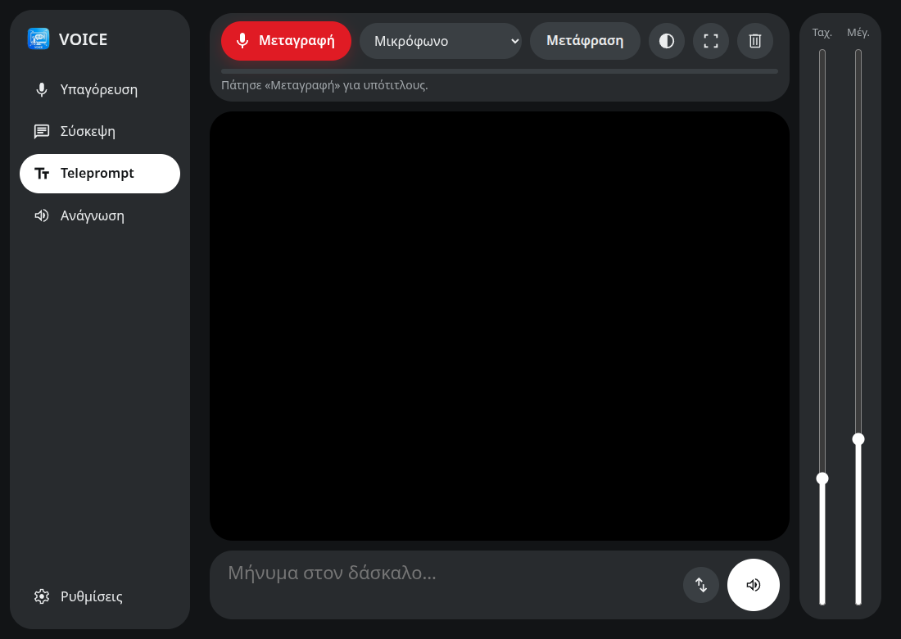

# VOICE desktop (Electron)

This is the desktop shell for the shared web UI in [`../web`](../web), which the Android app also runs. It has three features, all through Mistral Voxtral (there is no local AI):

- **Υπαγόρευση** (dictation)
- **Σύσκεψη** (meeting), with timestamps and speakers
- **Ανάγνωση** (read aloud)



## Running on Linux

```bash
npm install
npm start
```

## Building

- **Linux:** `npm run dist:linux` produces an AppImage and a .deb in `release/`.
- **Windows:** `npm run dist:win` produces an installer and a portable `.exe` in `release/`.
  - On Windows, build it there with Node 22+, `npm install`, then `npm run dist:win`.
  - From Linux it also builds (a portable exe was tested), but without wine the exe's icon and metadata are not set: `signAndEditExecutable: false`. For a full build use Windows, or install wine and remove that line.

`npm run copy-web` copies `../web` into `./web`, which is the folder that gets packaged. For development, `main.js` reads `../web` directly.

## Where each feature comes from

| | Linux | Windows |
|---|---|---|
| API key | `safeStorage`: libsecret/KWallet, file `~/.config/voice-desktop/mistral.key` | `safeStorage`: DPAPI |
| Microphone | `getUserMedia` | `getUserMedia` |
| System audio ("Ήχος υπολογιστή") | `parec` on the monitor of the default PulseAudio/PipeWire sink | `getDisplayMedia` with `audio: 'loopback'` (Chromium WASAPI loopback, no dialog) |
| Read aloud | **Piper** with the Greek voice `el_GR-rapunzelina` from the repo (`../piper_tts`, `../voices`) | `speechSynthesis`: the Windows Greek voice (Stefanos), if it is installed. Settings → Time & language → Speech → Add voices → Greek |

If Piper isn't found, Linux also falls back to `speechSynthesis`, which usually has no Greek voice. `VOICE_PIPER` / `VOICE_PIPER_MODEL` set different paths.

macOS has no system-audio capture.

## How the meeting works

This matches what the GTK app learned (`voice_gtk.py` MeetingPage):

- Audio goes in **~25 s chunks**, cut on the quietest 30 ms of the last 5 s. Chunks that are digital silence are not sent.
- With **"Και τα δύο"** (both sources), the microphone goes only as **VAD phrases**, labelled "Εγώ". The speakers go in 25 s chunks, labelled "Ηχεία".
- On stop, queued chunks are **always awaited**, never dropped.
- **Speakers:** with a single source, the whole recording (up to 1 hour) is sent once more with `diarize=true`. The result replaces the lines with "Ομιλητής 1, 2…".
  - The API does not accept `language` together with timestamps, so this pass auto-detects the language.
  - If it fails, the transcript with timestamps stays.
- `context_bias` is sent as repeated multipart fields, taken from the setting "Λέξεις που πρέπει να γράφει σωστά" (words it must spell right).
- The latest transcript and the dictated text are kept in `localStorage`, so they survive a restart.

## Teleprompt (live captions)

The same page as on Android, built for reading from a distance:

- large text with a font-size slider, and `Ctrl`+wheel to zoom;
- smooth, slow scrolling with a speed slider;
- dark/light contrast and full screen.

On the desktop, captions come from Mistral as **short VAD phrases** (≤12 s). Each phrase appears about 1–3 s after it ends; there are no 25 s chunks. Local whisper isn't wired in here; the GTK app has it.



Self-check of the shared core: `npm test` (`node ../web/test.js`).
